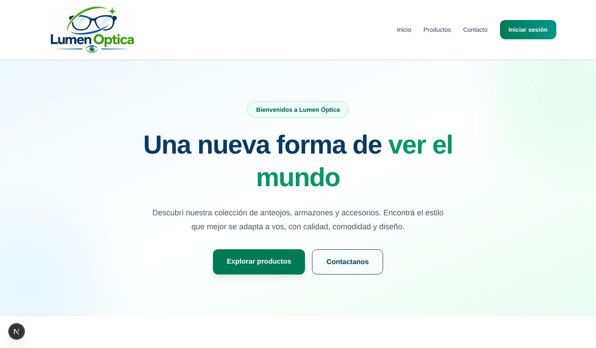
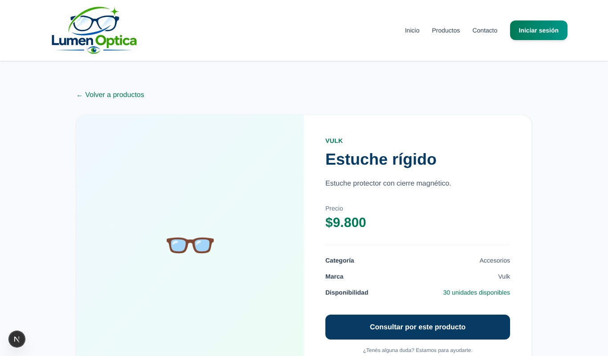
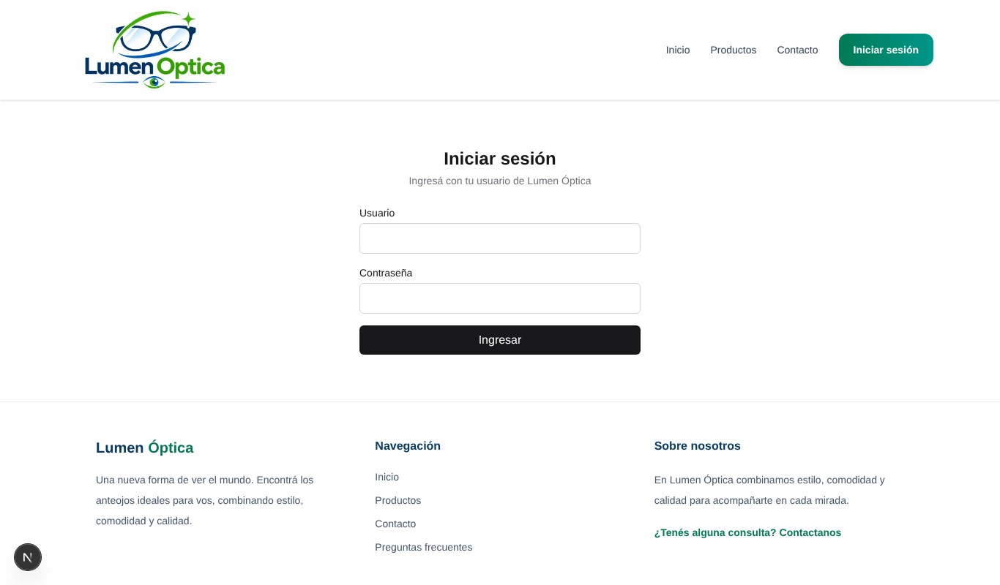
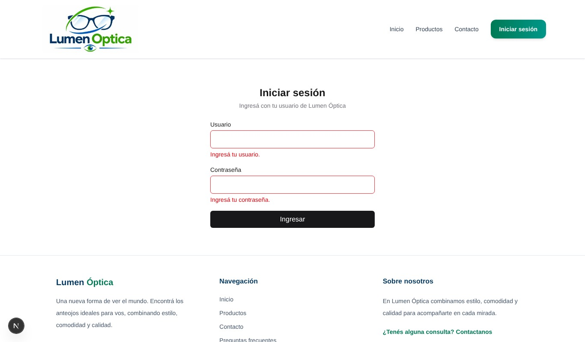
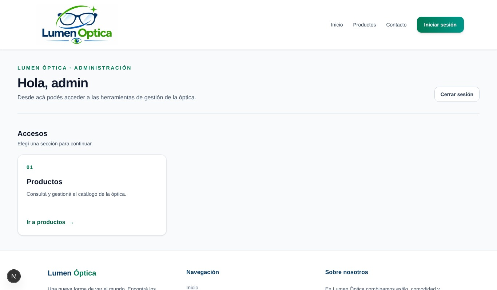
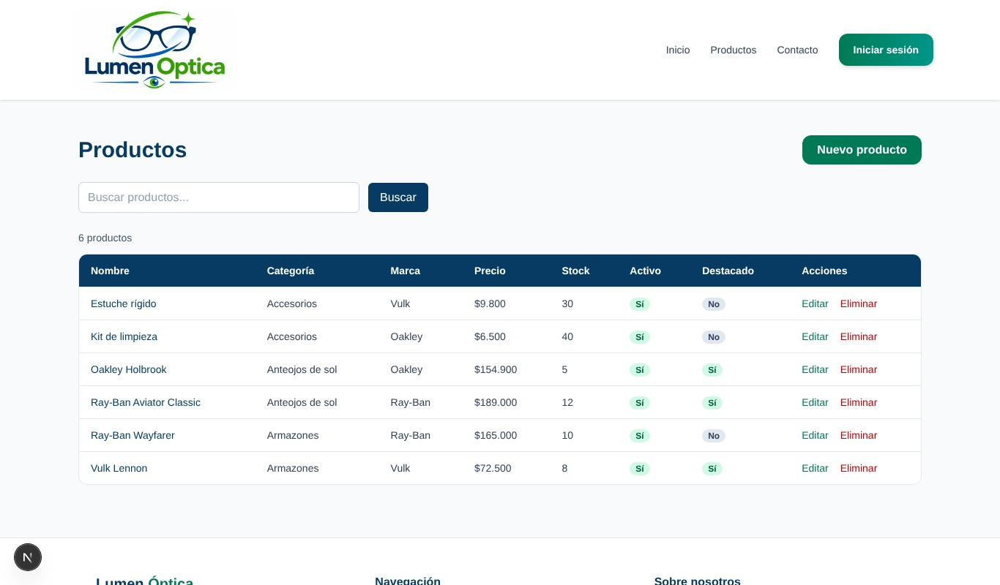
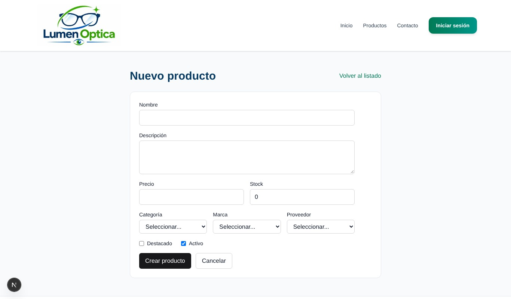
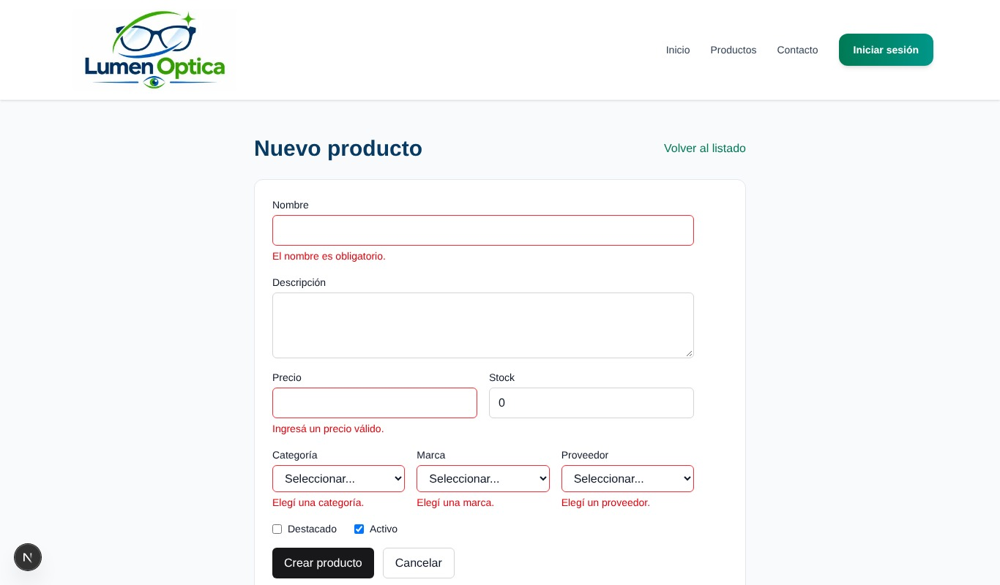

# Lumen Óptica — Frontend

Aplicación web para una óptica. Permite explorar el catálogo de productos y ofrece un panel protegido para administrar productos mediante una API REST. Está construida con Next.js, React y Tailwind CSS.

## Enlaces

- **Aplicación en producción:** [lumen-optica-frontend.vercel.app](https://lumen-optica-frontend.vercel.app)
- **API del backend:** [Documentación interactiva](https://lumen-optica-api.onrender.com/api/docs/)
- **Repositorio del frontend:** [candePicco/lumen-optica-frontend](https://github.com/candePicco/lumen-optica-frontend)
- **Repositorio del backend:** [candePicco/lumen-optica-backend](https://github.com/candePicco/lumen-optica-backend)
- **Tablero Kanban:** [Lumen Óptica — Desarrollo](https://github.com/users/JLaporte1/projects/1)

## Funcionalidades

- Catálogo público de productos con búsqueda, paginación y detalle.
- Inicio de sesión y rutas de administración protegidas.
- Panel de dashboard para gestionar productos: listar, crear, editar y eliminar.
- Formularios validados con Zod y React Hook Form.
- Páginas de inicio, contacto y preguntas frecuentes.

## Tecnologías

- Next.js (App Router) y React
- Tailwind CSS
- React Hook Form y Zod
- Vitest
- API REST desarrollada con Django

## Requisitos

- Node.js y npm instalados.
- El backend disponible en `http://localhost:8000` para desarrollo local, o una URL válida de la API.

## Instalación y ejecución local

1. Cloná el repositorio y entrá en la carpeta:

   ```bash
   git clone https://github.com/candePicco/lumen-optica-frontend.git
   cd lumen-optica-frontend
   ```

2. Instalá las dependencias:

   ```bash
   npm install
   ```

3. Creá `.env.local` en la raíz del proyecto y configurá la URL base del backend. No agregues `/api` al final:

   ```env
   API_URL=http://localhost:8000
   NEXT_PUBLIC_API_URL=http://localhost:8000
   ```

   Para usar el backend publicado, reemplazá ambos valores por `https://lumen-optica-api.onrender.com`.

4. Iniciá el servidor de desarrollo:

   ```bash
   npm run dev
   ```

5. Abrí [http://localhost:3000](http://localhost:3000).

`API_URL` se usa en las solicitudes del servidor y `NEXT_PUBLIC_API_URL` en las del navegador. En Vercel, configurá ambas variables para **Production**. `NEXT_PUBLIC_API_URL` queda incorporada durante el build, por lo que al cambiarla hay que volver a desplegar.

## Pruebas y otros comandos

```bash
npm run test    # Ejecuta Vitest
npm run lint    # Ejecuta ESLint
npm run build   # Genera el build de producción
npm run start   # Sirve el build localmente
```

## Despliegue

El frontend se despliega en Vercel desde la rama `main`. Para producción, las variables deben apuntar a `https://lumen-optica-api.onrender.com`, sin `/api` al final. El backend debe permitir en CORS el dominio de producción de Vercel.

## Capturas

Las capturas de la aplicación funcionando están en [`docs/capturas/`](docs/capturas/).

### Sitio público






### Inicio de sesión y administración













## Integrantes

| Integrante | Responsabilidad |
| --- | --- |
| Candela Picco | Interfaz, inicio, Navbar, Footer y contacto |
| Mateo Johnston Desancio | Productos, integración con API y CRUD |
| Federico Antonio Ramirez | Autenticación, Context y formularios |
| Juan Ignacio Laporte | Dashboard, pruebas y despliegue |
