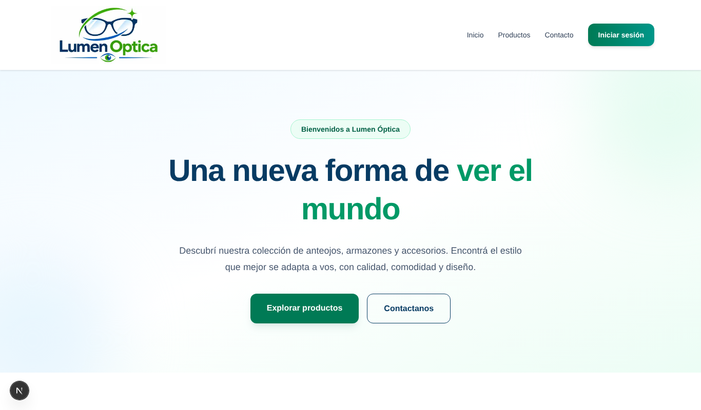
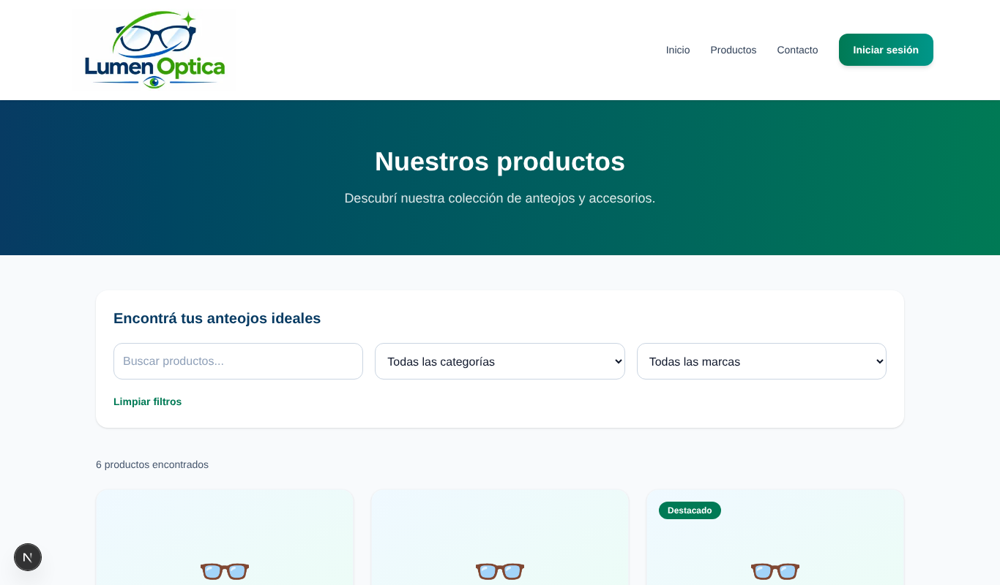
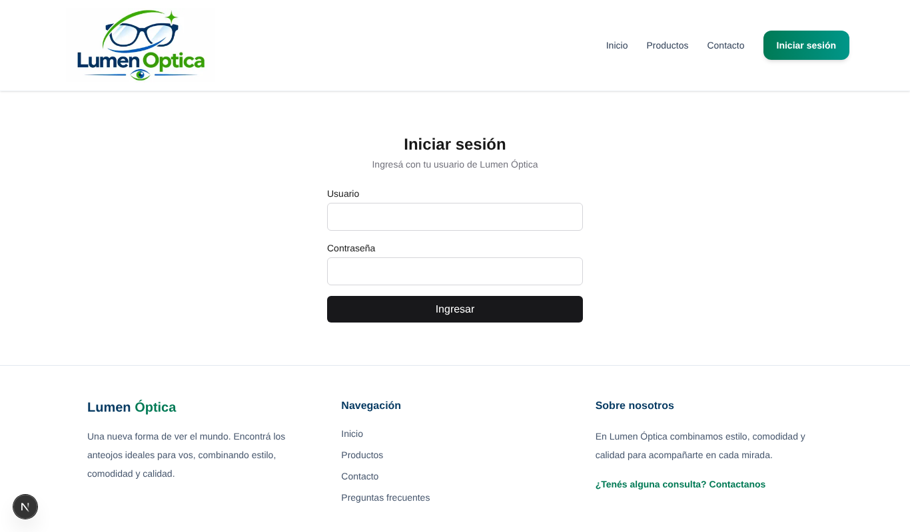
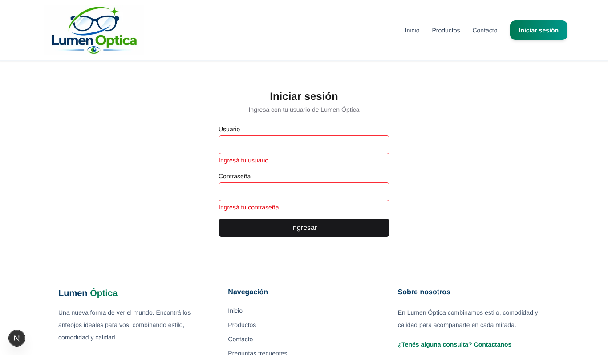
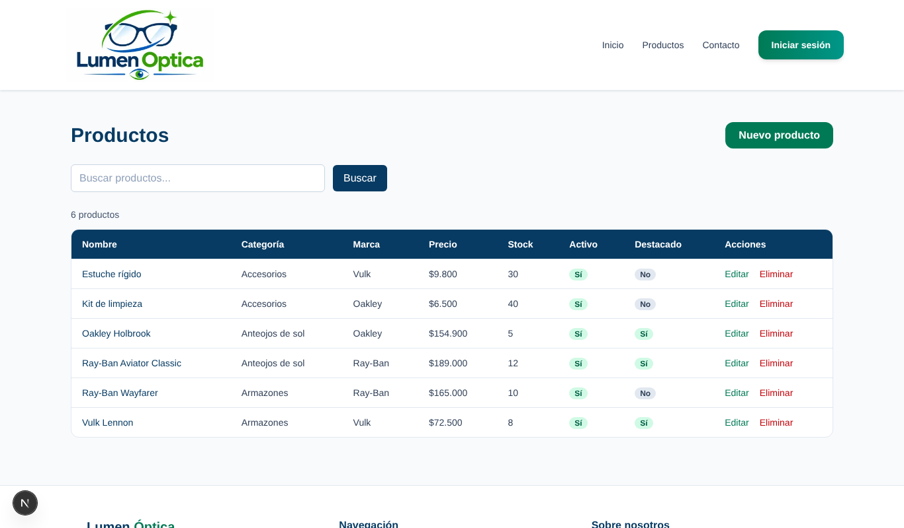
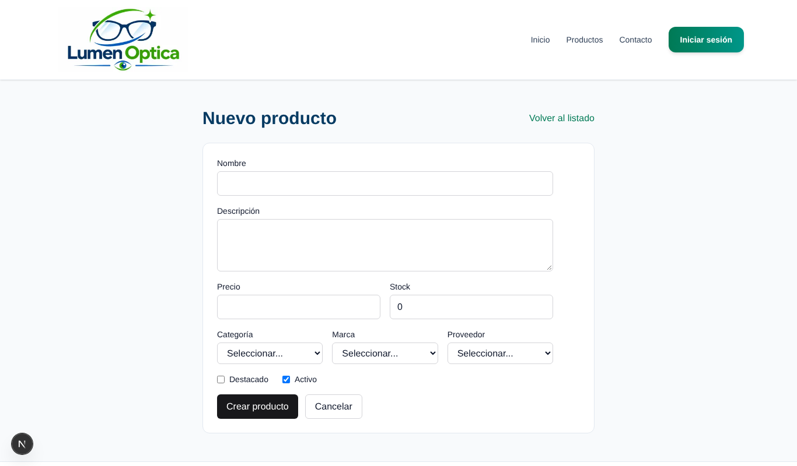
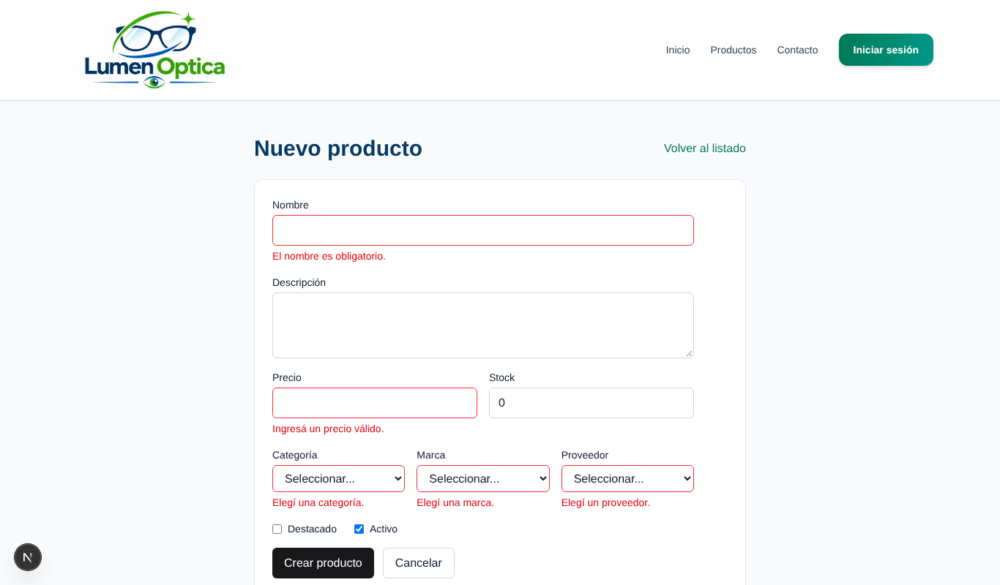

# Lumen Óptica — Frontend

Frontend de **Lumen Óptica**, una óptica online donde los clientes pueden recorrer el catálogo de anteojos de sol, armazones y accesorios, y el personal de la óptica puede administrar los productos desde un panel protegido.

Está desarrollado con **Next.js (App Router)** y **Tailwind CSS**, y consume la API REST hecha en Django REST Framework.

| | Enlace |
|---|---|
| 🌐 Aplicación desplegada | https://lumen-optica-frontend.vercel.app |
| 🔌 Documentación de la API | https://lumen-optica-api.onrender.com/api/docs/ |
| 🗂️ Repositorio del backend | https://github.com/candePicco/lumen-optica-backend |
| 📋 Tablero Kanban | https://github.com/users/JLaporte1/projects/1 |

> La API está en el plan gratuito de Render, que pausa el servicio cuando no se usa. La primera carga puede tardar unos segundos mientras el servidor se reactiva.

---

## Integrantes

| Integrante | Responsabilidad |
|---|---|
| Candela Picco | Interfaz, página de inicio, Navbar, Footer, contacto y preguntas frecuentes |
| Mateo Johnston Desancio | Productos, conexión con la API y CRUD |
| Federico Antonio Ramirez | Autenticación con JWT, Context API y formularios con React Hook Form + Zod |
| Juan Ignacio Laporte | Dashboard, tests y despliegue |

---

## Tecnologías

- **Next.js 16** (App Router) y **React 19**
- **Tailwind CSS 4**
- **React Hook Form** + **Zod** (con `@hookform/resolvers`) para formularios y validaciones
- **Context API** para manejar la sesión
- **JWT** (`djangorestframework-simplejwt` en el backend) para la autenticación
- **Vitest** para los tests
- **Vercel** (frontend) y **Render** (backend) para el despliegue

---

## Funcionalidades

### Parte pública
- Página de inicio con la presentación de la óptica.
- Catálogo de productos con búsqueda y filtros por categoría y marca.
- Detalle de cada producto.
- Página de contacto y preguntas frecuentes.
- Página 404 personalizada, y pantallas de carga y de error.

### Autenticación
- Inicio de sesión contra la API usando JWT (`/api/token/`).
- La sesión se guarda en el navegador y se mantiene al recargar la página.
- El token de acceso se renueva automáticamente con el refresh token (`/api/token/refresh/`).
- Cierre de sesión.
- Las rutas del panel están protegidas: si no hay sesión, se redirige al login y, después de ingresar, se vuelve a la página donde se estaba.

### Panel de administración (`/dashboard`)
- Listado de productos con búsqueda y paginación.
- Alta, edición y eliminación de productos (CRUD completo).
- Formulario de producto validado con Zod. Muestra tanto los errores de validación como los que devuelve la API.

---

## Rutas

| Ruta | Descripción | Acceso |
|---|---|---|
| `/` | Inicio | Público |
| `/productos` | Catálogo con búsqueda y filtros | Público |
| `/productos/[id]` | Detalle de un producto (ruta dinámica) | Público |
| `/contacto` | Contacto | Público |
| `/preguntas-frecuentes` | Preguntas frecuentes | Público |
| `/login` | Inicio de sesión | Público |
| `/dashboard` | Panel de administración | Requiere sesión |
| `/dashboard/productos` | Gestión de productos (ruta anidada) | Requiere sesión |
| `/dashboard/productos/nuevo` | Alta de producto | Requiere sesión |
| `/dashboard/productos/[id]/editar` | Edición de producto (ruta dinámica) | Requiere sesión |

La protección del panel se hace con un **layout anidado** (`src/app/dashboard/layout.js`) que envuelve todas sus páginas con el componente `ProtectedRoute`.

---

## Estructura del proyecto

```
src/
├── app/                      # Rutas (App Router)
│   ├── layout.js             # Layout raíz: AuthProvider, Navbar y Footer
│   ├── page.js               # Inicio
│   ├── loading.js / error.js / not-found.js
│   ├── productos/            # Catálogo y detalle
│   ├── contacto/
│   ├── preguntas-frecuentes/
│   ├── login/
│   └── dashboard/            # Panel protegido y CRUD de productos
├── components/               # Componentes reutilizables
├── context/
│   └── AuthContext.jsx       # Sesión, login, logout y authFetch
├── lib/
│   └── api.js                # Funciones para consumir la API de Django
└── schemas/                  # Esquemas de Zod y sus tests
```

### Server y Client Components

Por defecto los componentes son **Server Components**: se renderizan en el servidor y pueden pedir datos a la API directamente, por ejemplo el catálogo (`/productos`), el detalle de producto, el listado del panel, `Navbar`, `Footer` y `TablaProductos`.

Se usan **Client Components** (`"use client"`) solo donde hace falta interactividad o APIs del navegador: los formularios (`LoginForm`, `ProductoForm`, contacto), el `AuthContext` (usa `localStorage` y estado), `ProtectedRoute` (redirige según la sesión), `CatalogoProductos` (filtros en vivo) y `BotonEliminarProducto` (confirmación antes de borrar).

---

## Instalación y ejecución local

### Requisitos
- Node.js 20 o superior
- El [backend](https://github.com/candePicco/lumen-optica-backend) corriendo en `http://localhost:8000` (ver las instrucciones en su repositorio)

### Pasos

```bash
# 1. Clonar el repositorio
git clone https://github.com/candePicco/lumen-optica-frontend.git
cd lumen-optica-frontend

# 2. Instalar dependencias
npm install

# 3. (Opcional) Configurar variables de entorno
#    Crear un archivo .env.local en la raíz (ver la sección siguiente)

# 4. Levantar el servidor de desarrollo
npm run dev
```

La aplicación queda disponible en http://localhost:3000.

Para iniciar sesión hace falta un usuario creado en el backend (por ejemplo con `python manage.py createsuperuser`).

### Scripts disponibles

| Comando | Descripción |
|---|---|
| `npm run dev` | Servidor de desarrollo |
| `npm run build` | Compila la aplicación para producción |
| `npm run start` | Ejecuta la versión compilada |
| `npm run lint` | Revisa el código con ESLint |
| `npm run test` | Ejecuta los tests con Vitest |

---

## Variables de entorno

| Variable | Descripción | Valor local | Valor en producción |
|---|---|---|---|
| `NEXT_PUBLIC_API_URL` | URL base de la API de Django, **sin** `/api` al final | `http://localhost:8000` | `https://lumen-optica-api.onrender.com` |
| `API_URL` | URL de la API usada por las solicitudes del servidor, **sin** `/api` al final | `http://localhost:8000` | `https://lumen-optica-api.onrender.com` |

Ejemplo de `.env.local`:

```env
API_URL=http://localhost:8000
NEXT_PUBLIC_API_URL=http://localhost:8000
```

Si no se define ninguna variable, la aplicación usa `http://localhost:8000`, así que para trabajar en local no hace falta configurar nada.

> Las variables que empiezan con `NEXT_PUBLIC_` se incorporan al compilar. Si se cambian en Vercel, hay que volver a desplegar.

---

## Tests

Los tests están hechos con **Vitest** y validan los esquemas de Zod de login y de producto (`src/schemas/schemas.test.js`):

- Rechaza usuario y contraseña vacíos.
- Recorta los espacios del nombre de usuario.
- Convierte a número los campos numéricos del formulario de producto.
- Rechaza un precio igual a cero.

Para correrlos:

```bash
npm run test
```

---

## Despliegue

- **Frontend:** desplegado en **Vercel** desde la rama `main`. Configurá `API_URL` y `NEXT_PUBLIC_API_URL` con `https://lumen-optica-api.onrender.com` en el entorno **Production**.
- **Backend:** desplegado en **Render**. Para que el login funcione desde Vercel, el backend tiene que incluir la URL del frontend en `DJANGO_CORS_ALLOWED_ORIGINS`.

---

## Flujo de trabajo

Se trabajó con **GitFlow**:

- `main`: versión estable que se despliega.
- `develop`: integración de las funcionalidades.
- `feature/*`: una rama por integrante (`feature/interfaz-navegacion`, `feature/productos-crud`, `feature/auth-formularios` y `feature/dashboard-testing-deploy`).

Cada funcionalidad se integró a `develop` mediante Pull Requests, y después `develop` se integró a `main`. Las tareas se organizaron en el [tablero Kanban](https://github.com/users/JLaporte1/projects/1).

---

## Capturas

### Inicio


### Catálogo de productos


### Detalle de producto


### Inicio de sesión


### Validación del login


### Panel de administración


### Gestión de productos


### Alta de producto


### Validación del formulario de producto

